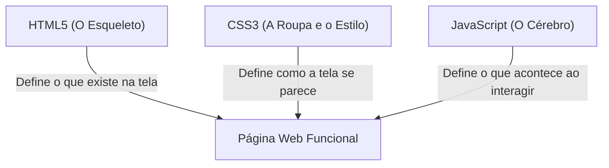
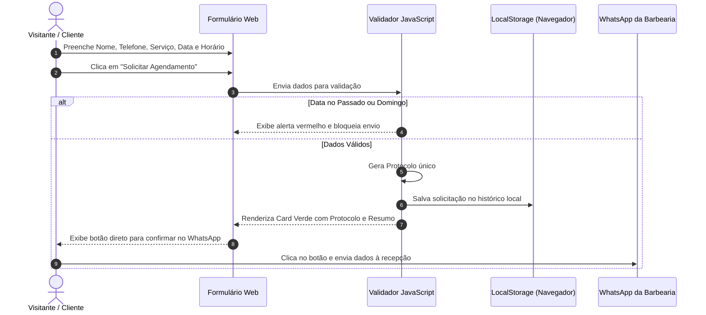

# 📖 Guia de Apresentação e Compreensão do Projeto
## Barbearia Azevedo Corta — Smart Web Experience (UniFECAF)
**Autor:** Lucas Azevedo  
**Disciplina:** Padrões Web para No Code e Low Code  
**Nível de Explicação:** Didático para Estudante Iniciante em Programação  

---

## 💡 Bem-vindo ao Guia de Apresentação!

Se você está começando na programação e precisa entender e explicar este projeto com segurança para professores, colegas ou avaliadores, este documento foi feito especialmente para você.

Aqui, cada conceito técnico é explicado em **linguagem simples**, com metáforas do dia a dia e exemplos práticos. Ao final da leitura, você saberá exatamente:
1. O que é o projeto e qual problema do mundo real ele resolve.
2. Como os arquivos e pastas estão organizados.
3. Como o HTML, o CSS e o JavaScript conversam entre si.
4. Como funciona o Consultor de Estilo (Automação de Visagismo).
5. Como funciona o Formulário de Agendamento com Protocolo e WhatsApp.
6. Quais são as limitações da aplicação e por que elas existem.

---

## 1. Visão Geral: O que é a Barbearia Azevedo Corta?

A **Barbearia Azevedo Corta** é uma aplicação web completa criada para uma barbearia física tradicional localizada no bairro do **Méier, Rio de Janeiro - RJ**.

### O Problema Real
Antes do projeto, a barbearia enfrentava problemas comuns a quase todos os pequenos comércios:
* **Informações perdidas no Instagram:** Os clientes tinham que rolar fotos antigas para tentar descobrir o preço de um corte ou se a barbearia abria aos domingos.
* **Barbeiros ocupados respondendo WhatsApp:** No meio de um corte com navalha ou tesoura, o barbeiro precisava parar o atendimento para digitar preços, horários e endereço.
* **Pedidos de agendamento errados:** Clientes mandavam mensagens pedindo horários para domingo (dia em que a barbearia está fechada) ou horários que já tinham passado.

### A Solução Criada
Desenvolvemos um site rápido, bonito e que funciona em qualquer aparelho (celular, tablet ou computador). O site oferece:
* Cardápio transparente de serviços e preços.
* Consultor Inteligente de Visagismo que recomenda o corte certo para o formato do rosto.
* Sistema de solicitação de horário com calendário que bloqueia automaticamente datas inválidas.
* Geração de um código de protocolo de reserva e envio da mensagem pronta para o WhatsApp da barbearia com um único clique.

---

## 2. Estrutura de Pastas Explicada de Forma Simples

Imagine o projeto como a construção de uma casa bem organizada. Cada pasta tem uma função única:

```text
barbearia-azevedo/
├── index.html            👉 A porta de entrada principal (Landing Page com tudo integrado)
├── pages/                👉 Os "cômodos" dedicados (Páginas de Serviços, Sobre, Contato, etc.)
├── css/                  👉 A "pintura e decoração" (Cores, fontes, tamanhos, espaçamentos)
├── js/                   👉 Os "motores e eletricidade" (Cliques, formulário, assistente, cálculos)
├── data/                 👉 A "agenda de informações" (Telefones, horários, preços centralizados)
├── images/               👉 O "álbum de fotos" (Fotos dos cortes, da equipe e do espaço)
├── docs/                 👉 O "manual de instruções e relatórios" (Trabalho acadêmico e guias)
└── tests/                👉 O "laboratório de testes" (Programinhas que verificam se nada está quebrado)
```

### Por que essa separação é importante?
Se precisarmos alterar o preço de um corte ou o telefone da barbearia, **não precisamos mexer em 10 páginas diferentes**. Basta abrir `data/config.js`, alterar o valor uma única vez, e todo o site é atualizado automaticamente!

---

## 3. As Tecnologias Utilizadas e seus Papéis

Em desenvolvimento web, utilizamos a "Santíssima Trindade" da internet (HTML, CSS e JavaScript), combinada com ferramentas modernas:



### 1. HTML5 (O Esqueleto)
* O HTML organiza o conteúdo em blocos com significado: usamos `<header>` para o cabeçalho, `<nav>` para os menus de navegação, `<section>` para cada seção e `<footer>` para o rodapé.
* **Por que isso importa na UniFECAF?** Motores de busca (como o Google) e leitores de tela para pessoas com deficiência visual conseguem entender perfeitamente o site graças a essa estrutura semântica.

### 2. CSS3 Modular (A Roupa e o Estilo)
* Em vez de colocar todo o estilo em um arquivo gigante e confuso, dividimos o CSS em pastinhas organizadas:
  * `css/base/`: Cores principais, fontes e regras gerais.
  * `css/components/`: Estilo dos botões, cartões de serviços e janelas modais.
  * `css/layout/`: Organização do cabeçalho, rodapé e grades.
  * `css/sections/`: Estilo específico de cada parte da página inicial.
* **Design Tokens (Variáveis CSS):** Criamos "apelidos" para as cores da barbearia no arquivo `variables.css`. Por exemplo, `--color-accent: #C8A97E` representa o tom Dourado Nobre. Se quisermos mudar o tom dourado do site inteiro no futuro, trocamos apenas essa linha.
* **Responsividade:** Usamos regras chamadas *Media Queries* no arquivo `responsive.css`. Elas detectam se a tela é pequena (celular) ou grande (computador) e adaptam o tamanho das fontes e colunas automaticamente.

### 3. JavaScript ES6+ (O Cérebro e as Ações)
* O JavaScript faz o site "ganhar vida":
  * Abre e fecha o menu do celular ao tocar no ícone de três barrinhas.
  * Abre a foto da galeria em tela cheia (modal Lightbox) ao clicar.
  * Valida se a pessoa digitou um telefone válido com DDD antes de enviar o agendamento.
  * Calcula as datas no calendário para proibir agendamento no passado ou no domingo.
* **Módulos (`import` e `export`):** Cada funcionalidade fica em um arquivo separado na pasta `js/`. Um módulo chama o outro quando precisa, como peças de Lego.

### 4. A Origem no Aura.build (No-Code)
* **Como o projeto começou?** Na primeira fase do trabalho acadêmico, o layout visual e a harmonia de cores foram prototipados na plataforma No-Code **Aura.build** (projeto *barbershop-landing-51*).
* **O Desafio da UniFECAF:** O edital do trabalho exigia que o aluno não ficasse preso apenas aos blocos prontos do construtor No-Code. Por isso, exportamos a ideia inicial e a reconstruímos em código aberto padrão W3C, adicionando as regras de agendamento e o assistente de estilo.

---

## 4. Como Funciona o Consultor Inteligente de Visagismo?

O Consultor de Estilo é o recurso de automação e inteligência do site. Ele fica em um botão flutuante no canto inferior direito da tela.

### O que é Visagismo?
Visagismo é a técnica que estuda o formato do rosto de uma pessoa (redondo, quadrado, oval, triangular) para indicar o corte de cabelo e o desenho de barba que mais valorizam suas características.

### Como o código funciona por dentro? (`js/ai-assistant.js`)
1. **100% Local (Client-Side):** Todo o cálculo acontece dentro do navegador da pessoa. Não enviamos mensagens para servidores externos caros de IA na nuvem (como ChatGPT ou Gemini). Isso significa que o assistente responde instantaneamente, não custa nada e funciona mesmo sem internet potente.
2. **Sistema Especialista por Regras Heurísticas:** O código contém um "dicionário" de conhecimento técnico (`visagismoRules`). Quando o usuário clica em *"Tenho rosto redondo"* ou digita sua dúvida:
   * O JavaScript procura palavras-chave como `redondo`, `bochecha` ou `fade`.
   * Ao encontrar a combinação, ele seleciona a melhor indicação: corte em degradê (*Skin Fade*), que alonga o visual e suaviza as bochechas.
3. **Card de Ação Integrado:**
   * O assistente exibe a recomendação e cria dois botões:
     1. **"Preencher no Formulário":** Rola a página suavemente até o agendamento e já seleciona o serviço correspondente.
     2. **"Agendar no WhatsApp com Mensagem Pronta":** Gera o link oficial com o texto completo já escrito.
4. **Proteção de Segurança (DOM XSS):** O texto digitado pelo visitante é tratado com a propriedade `textContent`, o que impede que qualquer pessoa mal-intencionada tente injetar códigos maliciosos no chat.

---

## 5. Como Funciona o Formulário de Agendamento? (`js/features/booking.js`)

O agendamento é uma das partes mais ricas e completas da aplicação. Ele não é apenas um formulário comum; ele possui **inteligência de regras de negócio**:



### As 5 Camadas de Inteligência do Agendamento:
1. **Validação de Data em Tempo Real:**
   * O código calcula o dia de hoje no fuso horário do Rio de Janeiro.
   * Se o usuário tentar escolher ontem ou qualquer dia anterior, o campo é bloqueado.
   * Se o usuário escolher um domingo, o JavaScript detecta o dia da semana (`d.getDay() === 0`) e exibe uma mensagem amigável: *"A Barbearia Azevedo fecha aos domingos. Por favor, escolha de segunda a sábado."*
2. **Validação de Horários Passados:**
   * Se a pessoa escolher agendar para *hoje*, o sistema desativa os horários do dia que já passaram (ex.: se agora são 15h, os horários das 09h às 14h ficam desabilitados).
3. **Geração de Protocolo Único:**
   * Toda solicitação bem-sucedida recebe um código exclusivo no formato `#AZV-2026-XXXXXX` (onde XXXXXX são números aleatórios gerados no momento).
4. **Livro de Registro Local (`localStorage`):**
   * O navegador guarda um histórico de agendamentos no computador do próprio cliente. Se a página for recarregada, o registro não se perde.
5. **Ponte Direta com o WhatsApp (`wa.me`):**
   * Como o site é estático (sem um servidor de banco de dados pago por trás), o agendamento monta uma mensagem completa e organizada para a recepção da barbearia, pronta para ser enviada com um toque no celular.

---

## 6. Recursos de Acessibilidade e Experiência do Usuário (UX)

O site foi construído pensando em todas as pessoas, incluindo idosos e pessoas com deficiência:
* **Alto Contraste:** O fundo escuro (Grafite `#0A0A0A`) contrasta com o texto claro e dourado, atingindo uma nota de contraste de **17.5:1**, muito acima do mínimo exigido pelas diretrizes internacionais da WCAG (que pedem 4.5:1).
* **Navegação por Teclado:** Qualquer pessoa pode navegar pelo site usando apenas a tecla `Tab`. Na galeria de fotos, a tecla `Escape` fecha o modal em tela cheia, e as setas do teclado mudam de foto.
* **Respeito à Preferência de Movimento (`prefers-reduced-motion`):** Se o usuário tiver labirintite ou desconforto com animações e tiver configurado o Windows para "reduzir animações", o CSS do site desativa efeitos de rolagem automática.

---

## 7. Limitações Conhecidas (Para você explicar com honestidade)

Em avaliações acadêmicas, **demonstrar maturidade e honestidade técnica vale muitos pontos**. Quando o avaliador perguntar sobre limites do projeto, você pode explicar:

1. **Confirmação Humanizada vs. Banco de Dados Centralizado:**
   * O site gera uma *solicitação de agendamento com protocolo prévio*, mas não dá baixa automática em um banco de dados de cadeiras em tempo real. A confirmação da vaga é realizada pela recepção no WhatsApp.
2. **Disparo de E-mail em Ambiente Estático (CORS):**
   * O site tem código pronto para envio por e-mail através do serviço FormSubmit. Porém, em servidores estáticos locais sem domínio próprio autenticado, navegadores modernos bloqueiam essa conexão silenciosa por segurança (CORS). Por isso, o WhatsApp é o canal principal e oficial de garantia do agendamento.
3. **Módulo de CEP:**
   * Criamos a integração técnica com a API do ViaCEP em `js/features/cep.js`. Ela serve como prova de conceito de consumo de APIs externas, embora a barbearia atenda exclusivamente no espaço físico no Méier.

---

## 8. Glossário Didático (Termos que você pode usar na apresentação)

| Termo Técnico | Significado Simples | Onde é usado no projeto? |
| :--- | :--- | :--- |
| **Padrões Web (W3C)** | Regras universais que garantem que um site funcione em qualquer navegador (Chrome, Safari, Edge, Firefox). | No HTML5 semântico, CSS3 e JavaScript do site. |
| **No-Code / Low-Code** | Ferramentas que permitem criar protótipos visuais com pouco ou nenhum código escrito manualmente. | Na prototipação inicial feita no **Aura.build** e no formulário **FormSubmit**. |
| **Design System** | Conjunto padronizado de cores, fontes e botões que dão a mesma identidade visual a todas as páginas. | Nas variáveis de `css/base/variables.css`. |
| **ES Modules** | Forma moderna do JavaScript de separar o código em vários arquivos com `import` e `export`. | Em todos os arquivos da pasta `js/`. |
| **DOM (Document Object Model)** | A estrutura viva da página que o JavaScript consegue ler e alterar quando o usuário clica ou digita. | No assistente de visagismo e na validação do formulário. |
| **DOM XSS** | Tipo de vulnerabilidade de segurança onde códigos maliciosos poderiam ser injetados no site. | Corrigido nas Etapas 11 e 12 com o uso de `textContent`. |
| **Path Traversal** | Tentativa de um invasor de acessar pastas fora do site usando `../`. | Bloqueado com 13 testes de segurança em `tests/server.js`. |
| **GitHub Pages** | Serviço gratuito do GitHub que coloca páginas estáticas no ar na internet. | Plataforma onde o projeto será publicado. |
| **Responsividade** | Capacidade de um site se moldar elegantemente ao tamanho da tela de qualquer aparelho. | Breakpoints em `css/responsive.css`. |

