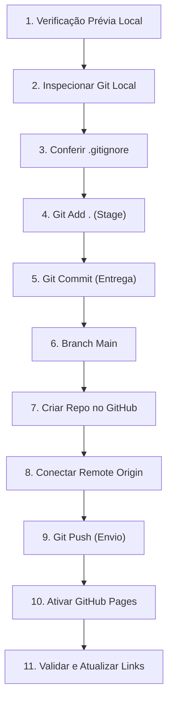

# 🚀 Guia Prático Passo a Passo: Publicação Manual no GitHub e GitHub Pages
## Projeto: Barbearia Azevedo Corta — Smart Web Experience (UniFECAF)
**Autor:** Lucas Azevedo  
**Objetivo:** Instruções detalhadas, didáticas e seguras para publicação manual do código no GitHub e ativação do site pelo GitHub Pages.

---

## 📌 Por que este guia foi feito para você?

Como estudante e desenvolvedor responsável pelo projeto, é fundamental que **você mesmo realize a publicação** na sua conta pessoal do GitHub. Dessa forma, você:
1. Mantém a autoria e soberania total sobre sua conta e seu repositório.
2. Pratica o fluxo real de trabalho de Git e GitHub utilizado no mercado de trabalho.
3. Garante que nenhuma senha, chave pessoal ou credencial de acesso seja compartilhada.

O projeto foi previamente auditado e testado. Este guia detalha exatamente cada comando, o que ele faz, o que esperar na tela e como resolver qualquer dúvida.

---

## 🗺️ Visão Geral do Processo (11 Passos)



---

### 🟢 PASSO 1: Verificação Prévia da Saúde do Projeto

Antes de enviar qualquer arquivo para a internet, vamos garantir que o site está 100% pronto e compatível com o GitHub Pages.

1. Abra o terminal (PowerShell, Git Bash ou terminal integrado do VS Code) diretamente na pasta do projeto:
   ```powershell
   # Dica: No VS Code, você pode usar o atalho Ctrl + ` para abrir o terminal já na pasta correta.
   # Se estiver abrindo o terminal manualmente pelo Windows:
   cd "caminho\para\sua-pasta\Trabalho Mod 2"
   ```
2. Execute o script validador oficial:
   ```bash
   node tests/check-gh-pages.js
   ```
3. **O que esperar:** A saída deve exibir uma lista de itens com `[PASS]` e concluir com a mensagem verde:
   `🎉 100% GITHUB PAGES COMPATIBLE ✅`.

---

### 🟢 PASSO 2: Inspecionar o Status do Repositório Git Local

Vamos conferir o que o Git está enxergando na pasta.

1. No terminal, execute:
   ```bash
   git status
   ```
2. **O que esperar:** O Git listará os arquivos não rastreados (*Untracked files*). Você verá pastas como `css/`, `js/`, `images/`, `pages/`, `docs/`, `data/`, `tests/` e arquivos como `index.html`, `README.md`, `.nojekyll` e `.gitignore`.
3. **Atenção:** Pastas temporárias de backups (`_backup_aura_original/`) e logs de ferramentas **não** devem aparecer aqui, pois estão bloqueadas pelo `.gitignore`.

---

### 🟢 PASSO 3: Conferir a Proteção do `.gitignore`

O arquivo `.gitignore` funciona como um "filtro de segurança", impedindo que backups antigos, logs ou arquivos do sistema operacional sejam enviados para o GitHub.

1. Para confirmar que o filtro está funcionando perfeitamente, execute:
   ```bash
   git check-ignore -v _backup_aura_original/
   ```
2. **O que esperar:** O terminal responderá mostrando a regra `.gitignore:2:_backup_aura_original/`, comprovando que o backup está protegido e nunca será enviado para a internet.

---

### 🟢 PASSO 4: Adicionar os Arquivos Legítimos ao Stage do Git

Agora vamos preparar os arquivos para o envio. No vocabulário do Git, isso se chama colocar os arquivos na "área de preparação" (*staging area*).

1. Execute o comando:
   ```bash
   git add .
   ```
   *(O ponto `.` indica que você deseja adicionar todos os arquivos da pasta atual que não estejam bloqueados pelo .gitignore).*
2. Em seguida, verifique o que foi adicionado:
   ```bash
   git status
   ```
3. **O que esperar:** Todos os arquivos aparecerão em **verde**, indicando que estão prontos para serem salvos no commit oficial.

---

### 🟢 PASSO 5: Criar o Commit Oficial de Entrega

O *commit* é como uma fotografia oficial do projeto naquele momento, com uma mensagem explicativa.

1. Execute o comando:
   ```bash
   git commit -m "feat: entrega oficial do trabalho Barbearia Azevedo Corta (UniFECAF)"
   ```
2. **O que esperar:** O Git confirmará a criação do commit, exibindo algo como:
   `[main (root-commit) a1b2c3d] feat: entrega oficial do trabalho Barbearia Azevedo Corta (UniFECAF)` seguido pelo número de arquivos inseridos (aproximadamente 98 arquivos).

---

### 🟢 PASSO 6: Garantir que a Branch Principal se Chama `main`

O padrão internacional e do GitHub é usar o nome `main` para o ramo principal do projeto.

1. Execute o comando:
   ```bash
   git branch -M main
   ```
2. Este comando garante que sua branch padrão está batizada como `main`.

---

### 🟢 PASSO 7: Criar o Repositório no seu GitHub

Agora vamos criar o espaço onde o seu projeto vai morar na nuvem do GitHub.

1. Abra o seu navegador e faça login na sua conta em: [https://github.com/](https://github.com/).
2. No canto superior direito da página, clique no ícone **`+`** e selecione **`New repository`** (ou acesse diretamente: [https://github.com/new](https://github.com/new)).
3. Preencha as opções exatamente como abaixo:
   * **Repository name:** `barbearia-azevedo` (ou outro nome curto em minúsculas).
   * **Description:** `Smart Web Experience — Experiência Digital da Barbearia Azevedo Corta (UniFECAF)`.
   * **Visibility:** Deixe selecionado **Public** (obrigatório para que a banca avaliadora consiga acessar e para ativar o GitHub Pages gratuitamente).
   * **Initialize this repository with:** **NÃO MARQUE NENHUMA CAIXA** (deixe desmarcadas as opções de *Add a README file*, *Add .gitignore* e *Choose a license*, pois seu projeto local já tem todos esses arquivos!).
4. Clique no botão verde: **`Create repository`**.
5. O GitHub exibirá uma página com a URL do seu repositório, que terá o formato:
   `https://github.com/SEU_USUARIO/barbearia-azevedo.git`

---

### 🟢 PASSO 8: Conectar o seu Repositório Local ao GitHub

Agora vamos ensinar ao Git do seu computador qual é o endereço na nuvem onde ele deve enviar os arquivos.

1. No terminal, execute o comando abaixo (substituindo `SEU_USUARIO` pelo seu usuário real do GitHub):
   ```bash
   git remote add origin https://github.com/SEU_USUARIO/barbearia-azevedo.git
   ```
2. Para conferir se a conexão foi registrada com sucesso, execute:
   ```bash
   git remote -v
   ```
3. **O que esperar:** Duas linhas mostrando o endereço do seu repositório:
   `origin  https://github.com/SEU_USUARIO/barbearia-azevedo.git (fetch)`  
   `origin  https://github.com/SEU_USUARIO/barbearia-azevedo.git (push)`

---

### 🟢 PASSO 9: Enviar os Arquivos para o GitHub (`git push`)

Este é o momento em que os arquivos saem do seu computador e sobem para o GitHub.

1. Execute o comando:
   ```bash
   git push -u origin main
   ```
2. **Autenticação:** Se for a primeira vez que você envia arquivos pelo terminal, o Windows abrirá uma pequena janela pop-up solicitando autorização do GitHub:
   * Clique em **Sign in with your browser** (Entrar pelo navegador).
   * Uma aba do navegador se abrirá; confirme o acesso clicando no botão verde de autorização.
   * Volte ao terminal.
3. **O que esperar:** O terminal mostrará o progresso do envio:
   `Enumerating objects: 110, done.`  
   `Writing objects: 100% (110/110)...`  
   `To https://github.com/SEU_USUARIO/barbearia-azevedo.git`  
   `* [new branch]      main -> main`  
   `Branch 'main' set up to track remote branch 'main' from 'origin'.`

Pronto! Atualize a página do seu repositório no navegador e você verá todo o código, pastas e o `README.md` formatado!

---

### 🟢 PASSO 10: Ativar o GitHub Pages (Colocar o Site no Ar)

Agora que o código está no GitHub, vamos transformar o repositório em um site navegável na internet.

1. Na página do seu repositório no GitHub, clique na aba **`Settings`** (Configurações), na barra superior de ícones.
2. No menu lateral esquerdo, procure a seção **Code and automation** e clique em **`Pages`**.
3. Na seção principal da página:
   * **Source:** Mantenha selecionado **`Deploy from a branch`**.
   * **Branch:** Onde está escrito `None`, clique e selecione **`main`**.
   * Ao lado, onde está a pasta `/(root)`, mantenha **`/(root)`**.
4. Clique no botão **`Save`** (Salvar).
5. **Aguarde a publicação:** O GitHub criará uma ação automática para publicar o site. Isso leva de 1 a 2 minutos.
6. Atualize a página de Settings > Pages após 1 minuto. Você verá uma caixa no topo com o aviso:
   > **Your site is live at https://SEU_USUARIO.github.io/barbearia-azevedo/**
7. Clique no link para abrir o seu site no ar!

---

### 🟢 PASSO 11: Validar o Site no Ar e Atualizar o README

Para fechar com chave de ouro e deixar a entrega perfeita para a UniFECAF:

1. **Teste a aplicação no ar:**
   * Abra o link no navegador do computador e do celular.
   * Teste a navegação pelas seções.
   * Abra a galeria de fotos e o modal.
   * Abra o Consultor de Visagismo e gere uma recomendação.
   * Faça uma solicitação de agendamento de teste (verifique o protocolo `#AZV-2026-XXXXXX` sendo gerado).
2. **Atualizar o link real no README:**
   * Abra o arquivo `README.md` no seu editor.
   * No topo, no item `3. Link Público da Aplicação:`, substitua o texto `Pendente de publicação no GitHub Pages` pelo link real gerado pelo GitHub:
     `https://SEU_USUARIO.github.io/barbearia-azevedo/`
   * Faça o mesmo para o link do repositório no item `2. Repositório GitHub:`.
   * Salve o arquivo e envie a atualização com:
     ```bash
     git add README.md
     git commit -m "docs: atualiza links oficiais do repositorio e do GitHub Pages"
     git push
     ```

---

## 🆘 Solução de Dúvidas e Problemas Frequentes

| Situação | Causa Provável | Como Resolver com Calma |
| :--- | :--- | :--- |
| O Git pediu usuário e senha, mas diz que a senha não é aceita. | O GitHub não aceita mais a senha da conta diretamente no terminal por segurança. | Use o botão de login pelo navegador (*Sign in with your browser*) ou gere um *Personal Access Token (classic)* em: GitHub > Settings > Developer Settings > Personal access tokens. |
| O comando `git remote add origin` deu erro dizendo `remote origin already exists`. | A conexão com o repositório já tinha sido criada anteriormente. | Execute `git remote set-url origin https://github.com/SEU_USUARIO/barbearia-azevedo.git` para atualizar o endereço correto. |
| O GitHub Pages abriu com a tela branca ou sem imagens. | O arquivo `.nojekyll` não foi enviado ou os caminhos não eram relativos. | Nosso projeto já possui o arquivo `.nojekyll` e todos os caminhos são 100% relativos (`images/`, `css/`), testados pelo script `check-gh-pages.js`. Basta limpar o cache do navegador (`Ctrl + F5`). |
| O site no GitHub Pages demora para atualizar após um commit. | O GitHub leva cerca de 60 a 90 segundos para recriar o cache de produção. | Aguarde 1 minuto e recarregue a página com `Ctrl + Shift + R` ou `Ctrl + F5`. |

---

> [!TIP]
> **Parabéns!** Seguindo este guia, seu projeto estará disponível publicamente na internet, com link seguro HTTPS, alta velocidade de carregamento e pronto para ser avaliado pela banca da UniFECAF!
