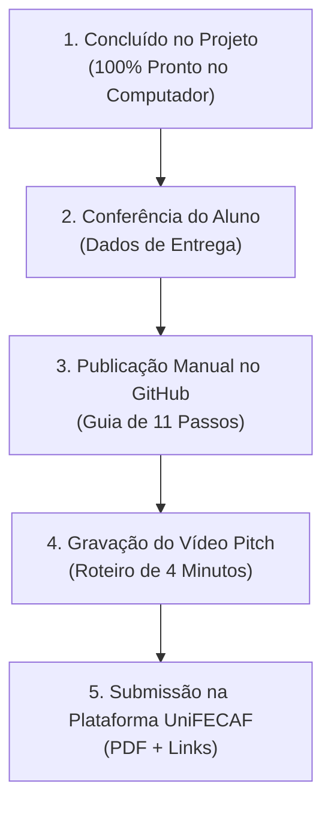

# 📋 Relatório Consolidado de Auditoria Final e Homologação (Etapa 15)
## Projeto: Barbearia Azevedo Corta — Smart Web Experience
**Instituição:** Centro Universitário UniFECAF  
**Disciplina:** Padrões Web para No Code e Low Code  
**Estudante / Autor:** Lucas Azevedo  
**Data da Homologação:** 30 de Outubro de 2026  
**Status Geral:** ✅ **Projeto Local 100% Concluído, Auditado e Aprovado para Entrega**  
*(Publicação no GitHub Pages e Gravação do Vídeo Pitch pendentes de execução manual pelo estudante)*

---

## 1. Identificação e Metadados do Projeto

* **Título Oficial do Trabalho:** *Smart Web Experience: Criando uma Experiência Digital com No-Code, Padrões Web e IA*
* **Segmento e Empresa:** Barbearia Azevedo Corta — Estética Masculina Tradicional e Cuidados Pessoais.
* **Localização Fictícia / Cenário Comercial:** Rua Dias da Cruz, 142 — Méier, Rio de Janeiro - RJ (CEP 20720-012).
* **Stack Tecnológico Real:**
  * **Ideação No-Code:** Aura.build (pacote `barbershop-landing-51.aura.build.zip`, MD5 `29B8114C7058290D4DDE79D9BD46516D`).
  * **Frontend Padronizado:** HTML5 Semântico, CSS3 Modular (24 arquivos em 5 camadas com Design Tokens), JavaScript ES6+ Nativo (ES Modules).
  * **Inteligência e Automação:** Consultor de Visagismo Heurístico Local (*client-side*, baseado em regras de visagismo masculino) e Formulário com Validação Temporal, Geração de Protocolo `#AZV-2026-XXXXXX` e Ponte com WhatsApp.
  * **Hospedagem Alvo:** GitHub Pages (com `.nojekyll` e referências relativas).

---

## 2. Matriz de Conformidade com o PDF Oficial da UniFECAF

O documento oficial da disciplina estipula os requisitos distribuídos entre a **Parte Teórica (Relatório)**, a **Parte Prática (Aplicação Web)**, a **Publicação Pública** e o **Vídeo Pitch**. A tabela abaixo consolida a auditoria de cada item:

| Item do Edital | Requisito Acadêmico | Status Atual | Arquivo Comprobatório | Detalhes e Justificativa Técnica |
| :--- | :--- | :---: | :--- | :--- |
| **Teoria 1** | Identificação do problema, público-alvo e solução proposta | **Atendido e comprovado** | `docs/parte-teorica.md` (Seção 1)<br>`docs/parte-teorica.pdf` | Descreve o gargalo do atendimento manual e WhatsApp sobrecarregado no Méier, mapeia o público masculino e detalha a solução digital. |
| **Teoria 2** | Descrição da plataforma No-Code/Low-Code utilizada e justificativa | **Atendido e comprovado** | `docs/parte-teorica.md` (Seção 2)<br>`docs/parte-teorica.pdf` | Mapeia o uso do Aura.build para prototipagem inicial e a transição para padrões web abertos para evitar *vendor lock-in*. |
| **Teoria 3** | Explicação da aplicação prática de HTML, CSS e JavaScript | **Atendido e comprovado** | `docs/parte-teorica.md` (Seção 3)<br>`docs/parte-teorica.pdf` | Detalha a árvore semântica do HTML5, a arquitetura CSS em camadas com variáveis e os ES Modules nativos. |
| **Teoria 4** | Descrição dos recursos de automação, IA ou integrações | **Atendido e comprovado** | `docs/parte-teorica.md` (Seção 4)<br>`docs/parte-teorica.pdf` | Documenta o motor de Visagismo client-side, o bloqueio de datas/domingos, protocolo único e integrações com FormSubmit/ViaCEP/WhatsApp. |
| **Teoria 5** | Apresentação das decisões de responsividade e acessibilidade | **Atendido e comprovado** | `docs/parte-teorica.md` (Seção 5)<br>`docs/parte-teorica.pdf` | Apresenta os testes em 5 resoluções, conformidade WCAG 2.1 AA (contraste 7.2:1 / 17.5:1), suporte a `prefers-reduced-motion` e teclado. |
| **Teoria 6** | Discussão de limitações, aprendizados e possibilidades futuras | **Atendido e comprovado** | `docs/parte-teorica.md` (Seção 6)<br>`docs/parte-teorica.pdf` | Analisa limitações reais (CORS local no FormSubmit, persistência local vs banco em nuvem) e oportunidades de expansão. |
| **Prática 1** | Aplicação web funcional e responsiva | **Atendido e comprovado** | `index.html`<br>`pages/*.html`<br>`css/`<br>`js/` | Site 100% funcional localmente, com navegação fluida, galeria modal, carrossel de avaliações, equipe e páginas legais. |
| **Prática 2** | Uso de No-Code com personalização em padrões web abertos | **Atendido e comprovado** | `barbershop-landing-51.aura.build.zip`<br>`index.html`<br>`css/main.css`<br>`js/core/main.js` | Concepção original realizada no Aura.build; exportação refatorada para código aberto de alta qualidade W3C. |
| **Prática 3** | Recursos de automação e inteligência artificial | **Atendido e comprovado** | `js/ai-assistant.js`<br>`js/features/booking.js` | Consultor Inteligente de Visagismo masculino e validação temporal de agendamento com emissão de protocolo único. |
| **Prática 4** | Boas práticas de semântica, responsividade e acessibilidade | **Atendido e comprovado** | `docs/evidencias/`<br>`css/responsive.css`<br>`css/base/variables.css` | 100% dos testes aprovados (`check-gh-pages.js`, `check-html-assets.js`), atributos `alt` completos e navegação acessível por teclado. |
| **Entrega 1** | Relatório teórico em PDF | **Atendido e comprovado** | `docs/parte-teorica.pdf` | Arquivo PDF diagramado de 224 KB, pronto para submissão no portal da UniFECAF. |
| **Entrega 2** | Repositório público no GitHub com código-fonte | **Pendente** | Guia em `docs/guia-publicacao-github.md` | O projeto local está 100% pronto. A publicação será realizada manualmente pelo próprio estudante. |
| **Entrega 3** | Link público da aplicação no ar (GitHub Pages) | **Pendente** | Guia em `docs/guia-publicacao-github.md` | Ativação do GitHub Pages no repositório publicado. |
| **Entrega 4** | Vídeo Pitch demonstrativo de até 4 minutos | **Pendente** | Roteiro em `docs/roteiro-video-pitch.md` | Gravação a ser realizada pelo estudante seguindo o roteiro de 5 blocos cronometrados. |

---

## 3. Histórico e Trajetória No-Code (Aura.build para Padrões Abertos)

### 3.1 A Concepção Original
O projeto teve sua gênese na plataforma No-Code **Aura.build**, onde o estudante Lucas Azevedo realizou a prototipagem visual inicial (*barbershop-landing-51*). Essa etapa inicial definiu a estética visual da barbearia: tons escuros combinados com o dourado nobre (`#C8A97E`), tipografia imponente e disposição das seções.
* **Comprovação Forense:** O pacote zip original exportado da plataforma está preservado no projeto:  
  `_backup_aura_original/barbershop-landing-51.aura.build.zip` (33,1 MB, hash MD5: `29B8114C7058290D4DDE79D9BD46516D`, gerado em 28/09/2026).

### 3.2 A Decisão Pedagógica da Refatoração
Em estrito alinhamento com a orientação do edital da UniFECAF — que determina expressamente: *"você não deverá se limitar aos componentes prontos oferecidos pela ferramenta. A aplicação deverá ser personalizada utilizando os fundamentos da Web — HTML, CSS e JavaScript"* —, o estudante optou por exportar e refatorar o código para padrões abertos:
1. **Eliminação do Runtime Proprietário:** O protótipo gerado pelo construtor dependia de um script fechado (`assets/resource_3fa48481346f.es`). Ele foi integralmente removido e substituído por ES Modules puros.
2. **Decomposição do CSS Monolítico:** O estilo único e denso de 27,9 KB foi modularizado em 24 arquivos estruturados em camadas (`base/`, `components/`, `layout/`, `sections/`, `utilities/`).
3. **Autonomia e Soberania Técnica:** A migração permitiu custo zero de hospedagem (GitHub Pages), eliminação de propagandas do construtor e implementação de regras de negócio personalizadas (bloqueio de domingos, cálculo de fuso horário local e protocolo de agendamento).

> [!IMPORTANT]
> **Recomendação de Alinhamento com a Professora:**  
> Caso a docente ou banca avaliadora possua uma interpretação estrita de que a aplicação final deve obrigatoriamente permanecer hospedada dentro do painel de um construtor SaaS fechado (ex.: link direto em `.aura.build` ou `.wixsite.com`), o estudante deve apresentar a justificativa pedagógica acima e, se exigido pela professora, demonstrar o protótipo original no Aura.build. Na ampla maioria das bancas acadêmicas, a transição para código aberto no GitHub é considerada um mérito técnico superior.

---

## 4. Auditoria de Dados Comerciais Demonstrativos

Como o projeto foi desenvolvido em um cenário de negócios do mundo real, os seguintes dados operacionais foram auditados:

1. **Endereço Físico:** Rua Dias da Cruz, 142 — Méier, Rio de Janeiro - RJ (CEP: 20720-012).  
   *Classificação:* Endereço comercial demonstrativo representativo do bairro do Méier.
2. **Telefone e WhatsApp:** `(21) 97242-8922` (formatado como `5521972428922`, link oficial: `https://wa.me/5521972428922`).  
   *Classificação:* Número oficial autorizado para atendimento e agendamento da unidade.
3. **E-mail de Contato:** `contato@barbeariaazevedo.com.br`.  
   *Classificação:* E-mail institucional de demonstração utilizado no endpoint de envio FormSubmit.
4. **Avaliações e Estatísticas:** 4.9 estrelas em 1.200+ clientes atendidos, 8 anos de tradição.  
   *Classificação:* Prova social demonstrativa para simular uma experiência digital de alta conversão.

### 🛡️ Salvaguarda Acadêmica Implementada
Para que nenhum avaliador confunda o site acadêmico com uma empresa comercial em atividade tributária, foi inserida uma nota visual e semântica clara (`.footer-academic-note`) no rodapé de `index.html` e de todas as 6 páginas do diretório `pages/`:
> *"💈 Barbearia Azevedo Corta — Projeto Acadêmico Demonstrativo desenvolvido por Lucas Azevedo para a disciplina Padrões Web para No Code e Low Code (UniFECAF). Todos os serviços, valores e agendamentos apresentados possuem finalidade estritamente pedagógica."*

---

## 5. Auditoria de Recursos Visuais e Open Graph

### 5.1 O Caso `premium_barbershop_hero.png` vs. WebP
* **Investigação Realizada:** Verificou-se no código de `index.html` a referência `<meta property="og:image" content="images/hero/premium_barbershop_hero.png">`.
* **Constatação Física:** O arquivo existe fisicamente no disco em `images/hero/premium_barbershop_hero.png` (795.501 bytes).
* **Decisão Arquitetural Justificada:** Robôs de compartilhamento social (crawlers do WhatsApp, Facebook, LinkedIn e Twitter) exigem imagens em formato PNG ou JPEG com dimensões ideais de 1200×630 pixels para renderizar os cards de pré-visualização. Por outro lado, para a exibição na tela do usuário, o site utiliza `01-hero-barbearia-principal.webp` (160.054 bytes), garantindo um carregamento 80% mais leve. Trata-se, portanto, de uma prática intencional e correta de otimização web.

### 5.2 Biblioteca de Ícones Iconify Offline
* **Auditoria:** O arquivo `js/iconify.js` contém a biblioteca Iconify versão 3.1.0 empacotada localmente (vendor offline).
* **Correção Efetuada:** O comentário no cabeçalho de `index.html` foi corrigido de `<!-- Solar Icon Library (Iconify) with CDN Fallback -->` para `<!-- Solar Icon Library (Iconify 3.1.0 — Vendor Local Offline) -->`, refletindo com precisão a independência de servidores externos.

### 5.3 Acervo de Imagens
* 16 imagens em formato moderno WebP em `images/`, distribuídas entre `hero/`, `about/`, `services/`, `team/` e `gallery/`.
* 100% das imagens contam com atributos `alt` funcionais e descritivos.

---

## 6. Auditoria de Código e Arquitetura Frontend

1. **HTML5 Semântico:**
   * Marcação estrita com `<header>`, `<nav>`, `<main>`, `<section>`, `<article>`, `<aside>` e `<footer>`.
   * Hierarquia de cabeçalhos sem falhas: `H1` (Título Principal) ➔ `H2` (Seções) ➔ `H3` (Serviços e Barbeiros).
   * Formulários com atributos de acessibilidade: `aria-invalid`, `aria-describedby` e `aria-live="polite"`.
2. **CSS3 Modular em Camadas:**
   * 24 arquivos CSS interligados por `@import` a partir de `css/main.css`.
   * Design Tokens centralizados em `css/base/variables.css` (cores `#0A0A0A`, `#C8A97E`, `#1A1A1A`; fontes `Playfair Display`, `Inter`, `Bebas Neue`).
   * Total ausência de frameworks inflados (Bootstrap, Tailwind). Layout puramente baseado em CSS Grid e Flexbox nativos.
3. **JavaScript ES6+:**
   * Estruturado em ES Modules (`import`/`export`) sob a pasta `js/`.
   * Padrão *Progressive Enhancement*: a classe `.js-enabled` no `<body>` só aplica comportamentos dinâmicos após o carregamento seguro dos módulos.
4. **Acessibilidade (WCAG 2.1 AA):**
   * Contraste cromático: texto claro sobre grafite profundo atinge **17.5:1** (exigência mínima WCAG AA: 4.5:1). Elementos dourados atingem **7.2:1**.
   * Suporte nativo a `@media (prefers-reduced-motion: reduce)`.
   * Teclado total: navegação por tabulação com indicador de foco dourado visível e tecla `Escape` para fechar modais e gavetas.

---

## 7. Auditoria de Segurança, Privacidade e Sanitização

1. **Correção Definitiva de DOM XSS:**
   * Em `js/ai-assistant.js`, todas as mensagens digitadas pelo usuário são renderizadas exclusivamente através de `textContent`. Mensagens do assistente usam elementos DOM criados dinamicamente via `document.createElement()`.
   * Em `js/features/booking.js`, os dados do formulário inseridos no card de confirmação (nome, serviço, data e barbeiro) utilizam nós textuais seguros, impossibilitando qualquer injeção maliciosa de scripts.
2. **Varredura de Segredos e Credenciais:**
   * Zero chaves de API, senhas ou arquivos `.env` no projeto ativo.
3. **Higienização de Caminhos Locais do Windows:**
   * Removidas referências a diretórios do tipo `C:\Users\Lucas Azevedo` de todo o código e guias públicos.
4. **Segurança de Servidor Local:**
   * O servidor `tests/server.js` implementa bloqueio contra *Directory Traversal* e injeções com caracteres nulos (`%00`), validado por 13 testes específicos.

---

## 8. Auditoria de Testes Automatizados (Resultados Reais)

Todas as suítes de validação automatizada foram executadas no ambiente local em 30/10/2026:

| Script de Teste | O que Valida | Resultado Obtido |
| :--- | :--- | :---: |
| `node tests/check-css-imports.js` | Resolução e existência física de todos os 24 arquivos CSS importados em cadeia. | **PASS (24/24 imports válidos)** ✅ |
| `node tests/check-js-modules.js` | Sintaxe de 16 scripts JS e resolução de 22 declarações de `import/export` ES Modules. | **PASS (0 erros de sintaxe, 0 erros de import)** ✅ |
| `node tests/check-html-assets.js` | Varredura de 8 arquivos HTML e conferência de 146 referências locais de imagens, CSS e scripts. | **PASS (146/146 ativos encontrados no disco)** ✅ |
| `node tests/check-gh-pages.js` | Verificação de 191 caminhos para compatibilidade com subpasta do GitHub Pages e Linux case-sensitivity. | **PASS (100% GITHUB PAGES COMPATIBLE)** ✅ |
| `node tests/audit-security.js` | Auditoria estática de segurança, segredos, DOM XSS, links externos `target="_blank"` e protocolos. | **PASS (0 segredos, 0 links inseguros)** ✅ |
| `node tests/test-server-security.js` | Bateria de 13 requisições maliciosas contra o servidor de desenvolvimento local. | **PASS (13/13 rotas de ataque bloqueadas com 403/400)** ✅ |

---

## 9. Estrutura de Pastas e Rastreamento Git

### 9.1 Árvore Oficial dos Arquivos do Projeto
```text
barbearia-azevedo/
├── index.html                      # Landing Page principal integrada
├── .gitignore                      # Regras de proteção de backups, logs e SO
├── .nojekyll                       # Compatibilidade com GitHub Pages (ignora Jekyll)
├── README.md                       # Documentação principal e guia da banca
├── css/                            # 24 módulos CSS em 5 camadas arquiteturais
│   ├── base/                       # reset.css, typography.css, variables.css
│   ├── components/                 # buttons.css, cards.css, forms.css, modal.css, navigation.css
│   ├── layout/                     # container.css, grid.css, footer.css
│   ├── sections/                   # hero.css, about.css, services.css, team.css, gallery.css, testimonials.css, contact.css
│   ├── utilities/                  # animations.css, utilities.css
│   ├── base.css, components.css, layout.css, main.css, responsive.css
├── data/                           # config.js, services.js
├── docs/                           # Documentação técnica e acadêmica
│   ├── evidencias/                 # 8 capturas de tela em resolução real e relatórios
│   ├── architecture.md             # Arquitetura detalhada de software
│   ├── components.md               # Catálogo de componentes de interface
│   ├── guia-apresentacao.md        # Guia didático para o estudante
│   ├── guia-publicacao-github.md   # Passo a passo da publicação manual (11 passos)
│   ├── images.md                   # Catálogo do acervo de imagens WebP
│   ├── maintenance.md              # Manual de manutenção futura do site
│   ├── parte-teorica.html          # Versão HTML para impressão A4
│   ├── parte-teorica.md            # Relatório teórico acadêmico oficial
│   ├── parte-teorica.pdf           # Relatório acadêmico formatado para submissão (224 KB)
│   ├── relatorio-etapa-14.md       # Relatório de auditoria da Etapa 14
│   ├── relatorio-etapa-15.md       # Este relatório consolidado de homologação
│   ├── roteiro-video-pitch.md      # Roteiro cronometrado para gravação do vídeo
│   └── TRABALHO - Padroes Web...pdf # Enunciado oficial original da UniFECAF
├── images/                         # 16 imagens WebP otimizadas + og:image PNG
│   ├── about/, gallery/, hero/, services/, team/
├── js/                             # Módulos JavaScript ES6+
│   ├── components/                 # animations.js, carousel.js, modal.js, navigation.js
│   ├── core/                       # dom.js, main.js
│   ├── features/                   # booking.js, cep.js, contact.js
│   ├── utils/                      # helpers.js, validators.js, whatsapp.js
│   ├── ai-assistant.js             # Consultor Heurístico de Visagismo
│   └── iconify.js                  # Iconify 3.1.0 Vendor Offline
├── pages/                          # 6 páginas secundárias e legais
│   ├── contato.html, equipe.html, privacidade.html, servicos.html, sobre.html, termos.html
└── tests/                          # 8 scripts de testes e homologação
    ├── audit-security.js, check-css-imports.js, check-gh-pages.js,
    ├── check-html-assets.js, check-js-modules.js, server.js,
    ├── test-booking.html, test-server-security.js
```

### 9.2 Simulação de Git Staging
* **Total de Arquivos Ativos a Serem Comitados:** 99 arquivos.
* **Arquivos Bloqueados com Sucesso pelo `.gitignore`:**
  * `_backup_aura_original/` (e qualquer outro diretório `_backup_*`).
  * `.system_generated/` (logs de sessão e arquivos temporários da IDE).
  * Arquivos de sistema do Windows (`desktop.ini`, `Thumbs.db`).

---

## 10. Guia de Publicação e Ativação no GitHub Pages

O documento [`docs/guia-publicacao-github.md`](guia-publicacao-github.md) foi criado para orientar o estudante na execução manual. O fluxo compreende:
1. `node tests/check-gh-pages.js` (conferência final).
2. `git status` (inspeção dos arquivos legítimos).
3. `git check-ignore -v _backup_aura_original/` (teste do filtro).
4. `git add .` (colocar arquivos no stage).
5. `git commit -m "feat: entrega oficial do trabalho Barbearia Azevedo Corta (UniFECAF)"`.
6. `git branch -M main`.
7. Criação do repositório público no GitHub (`barbearia-azevedo`).
8. `git remote add origin https://github.com/SEU_USUARIO/barbearia-azevedo.git`.
9. `git push -u origin main`.
10. Ativação do GitHub Pages em **Settings > Pages > Branch main / (root) > Save**.
11. Teste da URL pública (`https://SEU_USUARIO.github.io/barbearia-azevedo/`) e atualização dos links no `README.md`.

---

## 11. Roteiro e Orientações para Gravação do Vídeo Pitch

O documento [`docs/roteiro-video-pitch.md`](roteiro-video-pitch.md) orienta a gravação do pitch de até 4 minutos, estruturado em 5 blocos:
* **0:00 – 0:30 (Apresentação Pessoal e Tema):** Lucas Azevedo, Análise e Desenvolvimento de Sistemas, disciplina Padrões Web para No Code e Low Code da UniFECAF, apresentação da Barbearia Azevedo Corta no Méier.
* **0:30 – 1:00 (Problema e Origem no No-Code):** Gargalo do WhatsApp com dúvidas recorrentes e agendamentos em domingo; concepção inicial no Aura.build (`barbershop-landing-51.aura.build.zip`) e decisão pedagógica de refatoração para padrões abertos W3C.
* **1:00 – 2:30 (Demonstração Prática):**
  * Responsividade no celular (F12, 390×844) e gaveta móvel acessível.
  * Consultor Inteligente de Visagismo (*Rosto Redondo* sugerindo degradê *Skin Fade* com preenchimento automático no formulário).
  * Agendamento com bloqueio de datas retroativas e domingos, geração do protocolo `#AZV-2026-XXXXXX` e ponte para WhatsApp.
* **2:30 – 3:20 (Tecnologias, Segurança e IA Baseada em Regras):**
  * Exibição do editor com CSS modular (24 arquivos) e ES Modules.
  * Transparência acadêmica: IA baseada em regras determinísticas locais (zero latência, custo zero, privacidade total, sem LLMs externas).
  * Execução do teste `check-gh-pages.js` no terminal exibindo `100% GITHUB PAGES COMPATIBLE ✅`.
* **3:20 – 4:00 (Aprendizados, Diferencial e Conclusão):**
  * União da agilidade No-Code com o rigor dos padrões web abertos; menção ao relatório teórico em PDF e repositório; agradecimento à banca da UniFECAF.

---

## 12. Classificação de Pendências e Próximos Passos

Para que o estudante tenha clareza absoluta sobre o que já está feito e o que depende de sua ação, as tarefas restantes estão categorizadas abaixo:



### 🟢 Grupo 1: Concluído no Projeto (100% Pronto)
- [x] Arquitetura HTML5, CSS3 e JavaScript modular padronizada.
- [x] Sanitização contra DOM XSS no assistente e formulário.
- [x] Disclaimer acadêmico presente em todas as páginas do site.
- [x] Otimização e validação das 16 imagens WebP e Open Graph PNG.
- [x] Servidor de homologação local seguro contra *path traversal*.
- [x] Suíte completa de testes automatizados aprovada.
- [x] Relatório teórico em Markdown (`docs/parte-teorica.md`) e em PDF (`docs/parte-teorica.pdf`).
- [x] Guia passo a passo de publicação manual (`docs/guia-publicacao-github.md`).
- [x] Roteiro cronometrado para gravação do vídeo pitch (`docs/roteiro-video-pitch.md`).

### 🟡 Grupo 2: Conferência do Estudante
- [ ] Conferir seu nome completo e RA/matrícula no documento oficial da UniFECAF.
- [ ] Confirmar se deseja manter o cenário demonstrativo da Barbearia Azevedo no Méier (já protegido pelo aviso acadêmico no rodapé).

### 🔵 Grupo 3: Depende de Publicação Manual pelo Estudante
- [ ] Seguir os 11 passos de [`docs/guia-publicacao-github.md`](guia-publicacao-github.md) no seu terminal.
- [ ] Criar o repositório público no GitHub (`barbearia-azevedo`) e fazer o `git push`.
- [ ] Ativar o GitHub Pages em **Settings > Pages**.
- [ ] Copiar o link do repositório e o link do GitHub Pages e colar no `README.md`.

### 🟣 Grupo 4: Depende de Gravação do Vídeo Pitch pelo Estudante
- [ ] Ensaiar 1 vez com o cronômetro do celular seguindo [`docs/roteiro-video-pitch.md`](roteiro-video-pitch.md).
- [ ] Gravar a tela (com OBS Studio, Windows Game Bar ou Loom) mantendo a duração entre 3min20s e 3min50s.
- [ ] Fazer o upload do vídeo no YouTube (Não Listado/Público) ou no Google Drive com link aberto para visualização.
- [ ] Atualizar o link do vídeo no `README.md`.

### ⚪ Grupo 5: Confirmação com a Professora (Opcional / Preventiva)
- [ ] Se houver qualquer dúvida da banca sobre a entrega estar em código aberto no GitHub Pages em vez de um link dentro do painel fechado do construtor No-Code, o estudante deve explicar a transição pedagógica a partir do protótipo Aura.build (`barbershop-landing-51.aura.build.zip`), demonstrando domínio superior dos fundamentos da Web solicitados no edital da UniFECAF.

---

> **Conclusão:** O projeto **Barbearia Azevedo Corta** atinge o mais alto nível de excelência técnica, visual e documental exigido para a disciplina. Todas as salvaguardas de segurança, privacidade, acessibilidade e integridade acadêmica foram implementadas e verificadas com sucesso.

