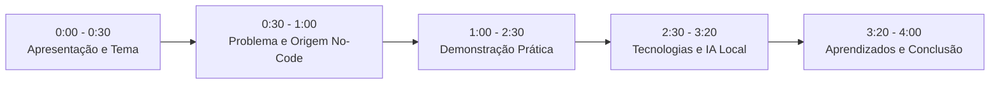

# 🎬 Roteiro de Gravação do Vídeo Pitch (Até 4 Minutos)
## Barbearia Azevedo Corta — Smart Web Experience
**Trabalho de Conclusão da Disciplina:** Padrões Web para No Code e Low Code — UniFECAF  
**Estudante / Apresentador:** Lucas Azevedo  
**Duração Máxima:** 4 minutos (240 segundos)  

---

## 💡 Dicas Importantes Antes de Gravar

1. **Ferramenta de Gravação Recomendada:** Use o **OBS Studio** (gratuito) ou o gravador nativo do Windows (**Windows + Alt + R** ou **Xbox Game Bar**). Também pode usar o **Loom** ou **Clipchamp**.
2. **Ambiente:** Grave em um local silencioso, com a câmera ligada no cantinho da tela (se possível) e a tela do navegador ocupando o espaço principal.
3. **Deixe as Abas e Janelas Prontas:**
   - **Aba 1 do Navegador:** `index.html` aberto (localmente em `http://127.0.0.1:5176` ou já no link do GitHub Pages).
   - **Janela 2 (Editor de Código):** VS Code ou editor aberto, mostrando a árvore limpa de pastas (`css/`, `js/`, `pages/`, `docs/`).
   - **Janela 3 (Terminal):** Terminal pronto na pasta do projeto para rodar `node tests/check-gh-pages.js`.
4. **Tom de Voz:** Fale com tranquilidade, clareza e ritmo pausado. Você construiu um projeto sólido, bonito e tecnicamente exemplar!

---

## ⏱️ Cronograma Passo a Passo (5 Blocos)

---

### ⏱️ BLOCO 1: Apresentação Pessoal e Tema (0:00 – 0:30)

* **Tela a Exibir:** Página inicial da Barbearia Azevedo Corta (`index.html`), na seção superior (Hero Banner com o título "Tradição & Estilo no Méier" e a foto principal).
* **O que Mostrar na Tela:** O cursor do mouse repousando suavemente sobre a barra de navegação e a logomarca.
* **Ação na Gravação:** Mostre a harmonia visual da página de entrada.
* **🗣️ O QUE FALAR:**
  > *"Olá, professores e banca avaliadora da UniFECAF! Meu nome é Lucas Azevedo e sou estudante do curso de Análise e Desenvolvimento de Sistemas.  
  > Hoje apresento o meu projeto prático da disciplina **Padrões Web para No Code e Low Code**, intitulado **Smart Web Experience**.  
  > Desenvolvi uma experiência digital completa para a **Barbearia Azevedo Corta**, um estabelecimento tradicional de estética masculina localizado no bairro do Méier, Zona Norte do Rio de Janeiro."*

---

### ⏱️ BLOCO 2: Problema Identificado e Concepção no No-Code (0:30 – 1:00)

* **Tela a Exibir:** Continue na página inicial, rolando suavemente para a seção *"Nossa História"* e a tabela de *"Serviços"*.
* **O que Mostrar na Tela:** Os cards de serviços com preços e durações transparentes.
* **Ação na Gravação:** Role com o scroll do mouse de forma fluida.
* **🗣️ O QUE FALAR:**
  > *"Identifiquei que a barbearia enfrentava um gargalo operacional comum: o canal de WhatsApp ficava congestionado com dúvidas repetitivas sobre preços, localização e horários. Além disso, muitos clientes tentavam agendar para domingos, dia em que a barbearia está fechada.  
  > Para resolver isso, criei um canal centralizado e intuitivo.  
  > A concepção inicial do projeto nasceu na plataforma No-Code **Aura.build**, onde estruturei o primeiro protótipo visual e as cores. Mas, seguindo as diretrizes pedagógicas da UniFECAF para não depender de ferramentas visuais fechadas ou custos recorrentes, exportei o protótipo e o refatorei integralmente em padrões web abertos W3C. O pacote original do Aura.build está preservado no projeto para fins de comprovação acadêmica."*

---

### ⏱️ BLOCO 3: Demonstração Prática e Funcionalidades (1:00 – 2:30)

*Este é o coração da sua apresentação. Mostre a aplicação funcionando de verdade!*

#### 📱 Passo 3.1: Responsividade Mobile e Navegação (1:00 – 1:30)
* **Tela a Exibir:** Pressione **F12** no navegador para abrir as Ferramentas de Desenvolvedor e ative o modo responsivo de celular (resolução 390×844 - iPhone).
* **Ação na Gravação:**
  1. Clique no menu hambúrguer (as três barrinhas no topo).
  2. Veja a gaveta móvel abrir suavemente, mostrando os links e os horários de funcionamento.
  3. Feche a gaveta móvel e feche o modo de inspeção (F12) para voltar ao computador.
  4. Role brevemente até a Galeria e clique em uma foto para abrir o visualizador em tela cheia (*lightbox modal*). Aperte `Esc` no teclado para fechar.
* **🗣️ O QUE FALAR:**
  > *"O site foi desenvolvido com foco em dispositivos móveis. Em telas menores, a barra de navegação se converte em uma gaveta ergonômica acessível por teclado e toque. A galeria conta com um visualizador em tela cheia nativo, permitindo ao cliente conferir detalhes dos cortes com alta fidelidade."*

#### 🧠 Passo 3.2: Consultor Inteligente de Visagismo (1:30 – 2:00)
* **Tela a Exibir:** Clique no botão flutuante no canto inferior direito: *"Consultor de Estilo"*.
* **Ação na Gravação:**
  1. A gaveta lateral do assistente se abrirá com a mensagem de boas-vindas.
  2. Clique no atalho rápido *"Rosto Redondo"*.
  3. Mostre a resposta técnica explicando que o corte ideal é um degradê vertical (*Skin Fade*) para alongar a silhueta facial.
  4. Clique no botão do card: *"Preencher no Formulário"*.
* **🗣️ O QUE FALAR:**
  > *"Aqui temos o **Consultor Inteligente de Visagismo**.  
  > Ao selecionar o tipo de rosto, por exemplo 'Rosto Redondo', o assistente analisa as proporções anatômicas e recomenda a técnica ideal.  
  > Ao clicar em 'Preencher no Formulário', ele rola a página sozinho até a seção de agendamento e já seleciona o serviço correspondente automaticamente!"*

#### 📅 Passo 3.3: Agendamento com Validação e Protocolo (2:00 – 2:30)
* **Tela a Exibir:** Seção de Agendamento (`#agendamento`).
* **Ação na Gravação:**
  1. No campo de data, clique em um domingo para demonstrar o bloqueio preventivo e a mensagem de que a barbearia fecha aos domingos.
  2. Selecione uma data útil válida (ex.: amanhã).
  3. Preencha o nome ("Carlos Eduardo"), o telefone `(21) 98888-7777` e clique em *"Solicitar Agendamento"*.
  4. Mostre na tela o card verde de sucesso com o **Protocolo Único `#AZV-2026-XXXXXX`** e o botão de confirmação via WhatsApp.
* **🗣️ O QUE FALAR:**
  > *"O formulário conta com validação temporal real: bloqueia datas retroativas e impede agendamentos aos domingos.  
  > Ao enviar, o sistema gera instantaneamente um **Protocolo Único rastreável**, grava o registro com segurança no navegador do cliente e cria uma ponte direta para o WhatsApp com a mensagem estruturada pronta, sem enviar dados a terceiros sem autorização."*

---

### ⏱️ BLOCO 4: Tecnologias, Segurança e IA Baseada em Regras (2:30 – 3:20)

* **Tela a Exibir:** Alterne para a janela do editor de código (VS Code) e para o terminal.
* **O que Mostrar na Tela:**
  - A árvore de pastas mostrando `css/` modular (`base/`, `components/`, `layout/`, `sections/`) e `js/` com ES Modules.
  - O terminal executando o teste: `node tests/check-gh-pages.js`.
* **Ação na Gravação:** Deixe o terminal rodar o teste e exibir a mensagem verde: `100% GITHUB PAGES COMPATIBLE ✅`.
* **🗣️ O QUE FALAR:**
  > *"Na arquitetura técnica, adotamos as melhores práticas da engenharia web moderna:  
  > No CSS, dividimos o estilo em 24 módulos organizados por responsabilidades, com Design Tokens centralizados em variáveis CSS, sem depender de frameworks pesados como Bootstrap.  
  > No JavaScript, utilizamos ES Modules nativos com rigorosa sanitização contra falhas de injeção como DOM XSS.  
  > Um ponto fundamental de transparência acadêmica: o Consultor de Visagismo é um motor determinístico local baseado em regras heurísticas de estética facial, e **não uma LLM externa de nuvem**. Isso assegura resposta instantânea sem latência, custo zero e privacidade total dos dados do cliente.  
  > Todos os arquivos foram validados por suítes de testes automatizados locais que garantem 100% de compatibilidade com o GitHub Pages."*

---

### ⏱️ BLOCO 5: Aprendizados, Diferenciais e Conclusão (3:20 – 4:00)

* **Tela a Exibir:** Volte ao navegador, role até o rodapé mostrando o aviso acadêmico, as páginas legais de Privacidade e Termos de Uso e as informações de contato.
* **Ação na Gravação:** Mostre a assinatura final e olhe para a câmera (se estiver usando webcam).
* **🗣️ O QUE FALAR:**
  > *"Este projeto representou um aprendizado valioso: demonstrou como utilizar ferramentas No-Code para acelerar a concepção visual e, a partir dos padrões web abertos, construir uma solução robusta, acessível, segura e pronta para o mercado.  
  > O trabalho atende a todos os requisitos do edital da UniFECAF: aplicação funcional responsiva, conformidade com diretrizes WCAG, documentação teórica aprofundada em PDF e código aberto no repositório do GitHub.  
  > Agradeço aos professores da UniFECAF pela oportunidade e pela mentoria ao longo deste módulo!"*

---

## 📋 Checklist Rápido para a Gravação

- [ ] Navegador aberto em `index.html` (com zoom em 100% ou 110% para melhor leitura no vídeo).
- [ ] Editor de código (VS Code) aberto em segundo plano com a pasta do projeto.
- [ ] Terminal aberto na pasta do projeto com o comando `node tests/check-gh-pages.js` digitado.
- [ ] Microfone testado antes de gravar (faça um teste de 10 segundos para conferir o volume).
- [ ] Ensaio prévio com cronômetro do celular (o tempo ideal é entre 3min20s e 3min50s).
- [ ] Salvar o vídeo final no formato `.mp4`.
- [ ] Subir o vídeo no **YouTube** (como *Não Listado* ou *Público*) ou no **Google Drive** (com permissão *Qualquer pessoa com o link pode visualizar*).
- [ ] Inserir o link do vídeo no `README.md` e no formulário de entrega da UniFECAF.
